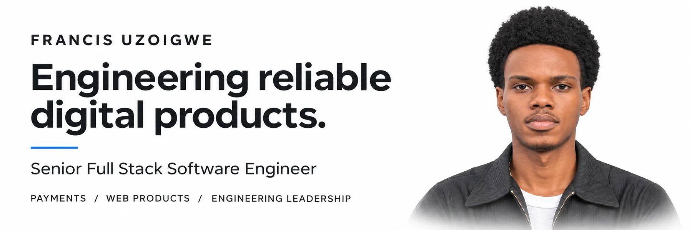

 

[Portfolio](https://francisuzoigwe.me) · [LinkedIn](https://www.linkedin.com/in/francisuzoigwe) · [Email](mailto:francis@syntiqhq.com)

## The problems I work on

I'm Francis, a software engineer based in **Lagos, Nigeria**, with **5+ years of experience** building payment systems, marketplaces and business applications.

I work across **TypeScript, React, Next.js, Node.js, PHP and Laravel**, from the customer interface to APIs, databases and production delivery. I like the problems behind the feature: a payment being processed twice, stock getting out of sync, or a release taking too much manual effort.

## Engineering in practice

- **Payment reliability:** At **OuroPay**, implemented transfer idempotency and balance checks, clarified pending versus failed payment statuses, and supported a backend operating at approximately **900,000 transfers in a single month**.
- **Engineering leadership:** At **LemonWares**, led frontend architecture across **14 client projects** and mentored **four developers**. Introduced TypeScript strict mode, review checklists, automated testing and deployment pipelines.
- **Retail operations:** At **SalesDock**, connected point-of-sale checkout, online storefronts and shared inventory, with audit trails for sales, discounts and refunds.

## Selected work

### [Evalocal](https://github.com/thatmanfrancis/Evalocal)

**UK events marketplace · Payments and booking workflows**

Integrated Stripe for deposits, milestone payouts and billing notifications. Connected quotes to paid bookings and implemented permissions for customers, vendors and moderators.

[Browse the code](https://github.com/thatmanfrancis/Evalocal) · [Visit the product](https://evalocal.com)

This repository is a fork of the LemonWares project; the description above identifies my contributions.

### [Aakkio](https://github.com/thatmanfrancis/Aakkio)

**Learning platform · Multi-tenancy and performance**

Delivered recurring billing, role-based access, student progress APIs and instructor analytics. Improved Next.js rendering and caching, reducing First Contentful Paint from 2.5 to 1.4 seconds.

[Browse the code](https://github.com/thatmanfrancis/Aakkio) · [Visit the product](https://aakkio.com)

### [Hausevo](https://github.com/thatmanfrancis/Hausevo)

**Property technology · Tenancy and operations**

A real estate platform covering property listings, tenant management, maintenance, disputes and administrative workflows.

[Explore the repository](https://github.com/thatmanfrancis/Hausevo)

## Toolkit

  

- **Languages & application frameworks:** TypeScript, JavaScript, React, Next.js, Node.js, Express, PHP, Laravel
- **Data & integrations:** PostgreSQL, MySQL, MongoDB, Redis, Prisma, SQL, REST APIs, GraphQL, Stripe, bank integrations
- **Delivery & operations:** Git, GitHub Actions, CI/CD, automated testing, AWS, Terraform, Docker, Linux, Nginx, PM2, Sentry
- **Access & security:** Role-based access control

I choose tools around the problem and I'm open to learning new languages and frameworks when the work calls for them.

---

### Have an engineering problem worth solving?

Open to **full-stack, backend and frontend engineering opportunities**, including remote work and relocation.

**[Let's talk](mailto:francis@syntiqhq.com)** · [Portfolio](https://francisuzoigwe.me) · [LinkedIn](https://www.linkedin.com/in/francisuzoigwe)
